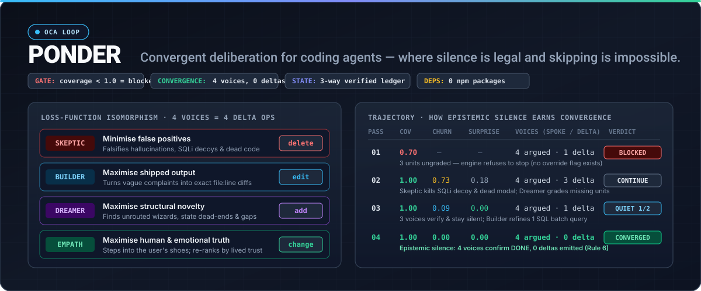
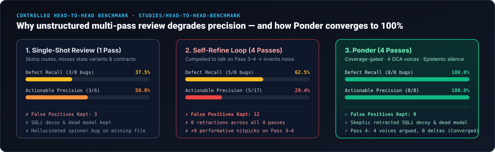

<div align="center">



<br />

[](LICENSE)
[](package.json)
[](test/conformance.sh)
[](package.json)
[](skill/ponder/SKILL.md)

**A convergent deliberation loop for coding agents.**  
Point it at a subject through a lens. It runs repeated passes — each one revising the last pass's findings on an append-only ledger rather than starting over — until further passes stop changing the answer.

[**Why Ponder?**](#why-ponder-exists) · [**How It Works**](#the-four-perspectives-are-the-four-delta-operations) · [**Studies & Benchmarks**](#empirical-studies--benchmarks) · [**Install**](#install) · [**60s Quickstart**](#60-second-quickstart) · [**The Phantom Rule**](#the-phantom-rule) · [**Full Spec**](SPEC.md)

</div>

---

## Why Ponder Exists

Ask a standard AI coding agent to audit a codebase or plan a major change, and you hit **three structural failure modes**:

### 1. Agents deliver half a goal and silently forget the rest
A long sweep decays. The first ten screens get real attention, the last thirty get a sentence each, and after a context compaction the agent no longer remembers there were forty.
- **How Ponder fixes it:** Ponder puts the inventory on disk (`units.json`) and gates the exit. While `coverage < 1.0`, `ponder judge` returns **`blocked`** and `ponder decide stop` exits `2`, naming every unit that was never graded. There is no `--force` flag. An incomplete stop is not discouraged — it is **structurally impossible**.

### 2. When an LLM doesn't know — or is asked to review a second time — it manufactures noise
Current AI models are trained to equate helpfulness with token generation. If a route file is missing, a single-shot review will often assume what is inside it and hallucinate findings. Worse, if you run an unstructured multi-pass loop (*"Critique and improve your previous review"* for 4 passes), by Pass 3 the real bugs are already listed — yet the model feels compelled to justify its turn by inventing speculative nitpicks (`React.memo` everywhere, BEM class renaming, dark-mode wrappers) while never retracting its Pass-1 false positives.
- **How Ponder fixes it (`Epistemic Silence`):** Ponder separates **having a perspective** from **mutating state**. Every pass records `voices` (how many perspectives inspected the evidence and argued in `deliberation.json`) separately from `deltaVoices` (how many emitted a revision in `deltas.jsonl`). When a finding already holds, **silence is the desired output**. Two consecutive passes where all voices verify the evidence (`voices >= 3`, `confidenceFloor == 0`) and almost nothing moves (`novelty < 0.05`, `churn < 0.10` — culminating in `0` deltas) earn **`stop (converged)`**.

| Pass 4 in an Unstructured LLM Loop | Pass 4 in Ponder (`Epistemic Silence`) |
|---|---|
| *"You asked me to refine the review again, so here are 5 new items: wrap `DashboardScreen` in `React.memo`, adopt BEM class names, extract `$29` into a constants file, add OpenTelemetry spans..."*<br/><br/>**Outcome:** Actionable precision collapses to **29.4%**. Real bugs get buried under performative churn. | **`skeptic`:** *"VOTE: DONE. Re-verified all 11 open findings and 14 file:line anchors on disk. Emitting 0 deltas."*<br/>**`builder` · `dreamer` · `empath`:** *"VOTE: DONE. Emitting 0 deltas."*<br/><br/>**Outcome:** `voices: 4` · `deltaVoices: 0` · `churn: 0.00` · `surprise: 0.00` → **`stop (converged)`**. |

### 3. Code-only review is blind to the human — and the emotion — on the other side of the screen
Standard static review reads code from the compiler's point of view. It checks whether types match and handlers compile, but it never steps into the shoes and emotional state of the human using the software:
- *How does a team member feel when the survey page promises their answers are only shown in aggregate after 3 responses, but the admin table prints their individual score next to their name at `N = 1`?*
- *How does a first-time user feel when an onboarding wizard demands an "Internal schema version" and "Priority tier" before they have even seen the workspace?*
- *Whose convenience won when an engineer built a 7-field form because the database table had 7 columns?*
- **How Ponder fixes it:** Ponder's lenses ([`ui`](lenses/ui.md), [`product`](lenses/product.md), [`copy`](lenses/copy.md)) and the **Empath** voice force the agent to step outside the codebase, inhabit each actor's lived and emotional perspective, and re-rank findings by human trust and task survival rather than code proximity.

> [!IMPORTANT]
> **Ponder never edits your source code.** It deliberates until the finding set converges, verifies the append-only ledger against disk, and hands back an ordered, evidence-anchored plan (`ponder apply`).

---

## Install

One-line install (clones to `~/code/ponder` or `$PONDER_HOME` and symlinks into your agent harnesses and `PATH`):

```sh
curl -fsSL https://raw.githubusercontent.com/Quinnod345/ponder/main/install.sh | sh
```

Or from a local checkout:

```sh
git clone https://github.com/Quinnod345/ponder.git ~/code/ponder
~/code/ponder/install.sh
```

That symlinks:

| From | To | What it is |
|---|---|---|
| [`skill/ponder`](skill/ponder/SKILL.md) | `~/.claude/skills/ponder` | Claude Code skill (`/ponder`) |
| [`skill/ponder`](skill/ponder/SKILL.md) | `~/.agents/skills/ponder` | OpenClaw / shared agents skill |
| [`skill/ponder`](skill/ponder/SKILL.md) | `~/.codex/skills/ponder` | Codex skill (when `~/.codex` exists) |
| [`bin/ponder`](bin/ponder) | `~/.local/bin/ponder` | CLI engine on `PATH` |

Re-running is safe: it replaces its own symlinks and refuses to clobber a real directory. Verify your environment anytime with `ponder doctor`.

**Requirements:** Node (`>= 18`) and, optionally, `psql`. **There are zero npm dependencies** — not a short list, zero. No `node_modules`, no lockfile, nothing to install. The conformance suite enforces it ([`SPEC 8.5`](SPEC.md)).

---

## Empirical Studies & Benchmarks

<div align="center">

</div>

Full methodology, target application source code, raw pass outputs, and production field studies are committed in **[`studies/`](studies/README.md)**.

### 1. Controlled Head-to-Head Benchmark ([`studies/head-to-head-benchmark/`](studies/head-to-head-benchmark/))

We evaluated **Single-Shot Review (1 pass)**, **Unstructured Self-Refine (4 passes)**, and **Ponder (4 passes)** against a reproducible SaaS target application ([`target-app/`](studies/head-to-head-benchmark/target-app/)) containing **8 planted ground-truth bugs (`GT-1`–`GT-8`)** and **3 adversarial traps**:
- **`TRAP-DECOY-SQLI` ([`safe-query.js`](studies/head-to-head-benchmark/target-app/src/lib/safe-query.js)):** A tagged template `sql\`SELECT ... WHERE id = \${memberId}\`` that looks like SQL injection at the call site but compiles into parameterized `$1, $2` bindings inside the helper.
- **`TRAP-ORPHAN` ([`legacy-v1-modal.jsx`](studies/head-to-head-benchmark/target-app/src/screens/legacy-v1-modal.jsx)):** A component with low-contrast `#ccc` text on `#fff` that has **zero importers** anywhere in the repository.
- **`TRAP-PHANTOM` ([`router.js`](studies/head-to-head-benchmark/target-app/src/router.js)):** A route entry pointing to `src/screens/legacy-export.jsx`, a file that **does not exist on disk**.

| Metric | Single-Shot (1 Pass) | Unstructured Self-Refine (4 Passes) | **Ponder (4 Passes)** |
|---|---:|---:|---:|
| **Ground-Truth Recall (`GT-1`–`GT-8`)** | `3/8` (37.5%) | `5/8` (62.5%) | **`8/8` (100.0%)** |
| **Actionable Precision (`TP / Reported`)** | `3/6` (50.0%) | `5/17` (29.4%) | **`8/8` (100.0%)** |
| **False Positives in Final Plan** | `3` | `12` | **`0`** |
| **SQLi Decoy (`TRAP-DECOY-SQLI`)** | Kept false positive | Kept across 4 passes | **Retracted by Skeptic (Pass 2)** |
| **Dead Code (`TRAP-ORPHAN`)** | Graded dead file | Kept across 4 passes | **Retracted + unit removed (Pass 2)** |
| **Phantom Route (`TRAP-PHANTOM`)** | Hallucinated spinner bug | Kept hallucination | **Verified missing on disk (`phantom: true`)** |
| **Pass 3–4 Performative Noise** | N/A | `9` invented low-signal items | **`0` (Pass 4: 4 voices, 0 deltas)** |
| **Final Session Status** | Unverified opinion | Drifting / un-converged | **`converged` (Rule 6 — 0 overrides)** |

Run the evaluator and ledger verifier yourself in `<100ms`:

```sh
node studies/head-to-head-benchmark/evaluate.mjs
```

### 2. Production Field Studies ([`studies/field-studies.md`](studies/field-studies.md))

| Field Study | Surface Size | Key Discovery Made Only After Pass 1 |
|---|---:|---|
| **[Study 1 — B2B SaaS UI Sweep](studies/field-studies.md#field-study-1-228-unit-saas-ui-sweep)** | **228 units** (vs. 30 route files) | Caught a 60-second background poll silently wiping mid-edit user state (`must`, score 1); **Skeptic** retracted 11 false positives on 5 unimported v1 components. |
| **[Study 2 — Security & Webhook Audit](studies/field-studies.md#field-study-2-154-surface-security--efficiency-audit)** | **154 surfaces** (APIs, actions, SQL) | Caught a Stripe webhook idempotency bug that permanently dropped retries after transient DB errors; **Skeptic** retracted 5 false CSRF/SQLi alarms. |
| **[Study 3 — Emotional & Privacy Audit](studies/field-studies.md#field-study-3-first-time-user--emotional-privacy-audit)** | **16 user journeys** | Walking the app as both Participant and Admin exposed a 3-way anonymity contradiction (`>=5` on landing copy, `>=3` in survey header, `>=1` in admin results). |
| **[Study 4 — Interactive Portfolio Sweep](studies/field-studies.md#field-study-4-37-unit-interactive-portfolio-deliberation)** | **37 units** (WebGL, motion, mobile) | Converged subjective motion & typography in 4 passes with `0.00` thrash and `surprise` falling `0.04 → 0.02 → 0.00`. |

---

## How Ponder Compares to the State of the Art

| Mechanism | Standard LLM Review / `Self-Refine` | Multi-Agent Debate (`ChatEval`, `CrewAI`) | **Ponder** |
|---|---|---|---|
| **When a voice has nothing new to add** | Manufactures nitpicks or hallucinates to justify the turn | Agents speechify or repeat agreement in prose | **Epistemic silence:** `voices` (who verified & argued) is tracked separately from `deltaVoices` (who mutated state). `0` deltas after full review proves convergence |
| **Role-to-action mapping** | Unstructured prose rewrite of the whole output | Open-ended roleplay personas with overlapping outputs | **Loss-function isomorphism:** 4 cognitive voices map 1-to-1 onto the 4 delta operations (`Skeptic` → `delete`, `Builder` → `edit`, `Dreamer` → `add`, `Empath` → `change`) |
| **Emotional & human perspective** | Evaluates code from the compiler's / developer's view | Ad-hoc persona prompts without structural power | **Structural perspective-taking:** **Empath** owns `change` (re-scoring & re-ranking severity/confidence from the human user's lived & emotional state) |
| **Stopping criterion** | Fixed $N$ iterations or "stop when satisfied" | Majority vote or moderator summary | **8 quantitative signals** (`coverage`, `novelty`, `churn`, `thrash`, `surprise`, `stall`, `confidenceFloor`, `voices`) evaluated by deterministic verdict rules |
| **Shortcut & tamper resistance** | None — agent can skip files or drop items silently | None — transcript-only | **Adversarial hardening:** Un-overridable coverage gate (`coverage < 1.0` = `blocked`), **Phantom Rule** (disk + full path-history verification), and **3-way ledger reconciliation** (`ponder verify`) |
| **Self-modeling** | None | None | **Predictive coding (`predict` → `surprise`):** Each pass forecasts its own churn before working; falling `surprise = \|predicted - actual\|` proves the loop models itself |

---

## The Loop

Each phase borrows a layer from the [Oneiro Cognitive Architecture (`oneiro-oca`)](https://github.com/Quinnod345/oneiro-oca). Ponder is OCA's loop pointed at a software subject instead of at a machine's own existence.

```
                      ┌──────────────────────────────────────────────┐
                      │                                              │
                      ▼                                              │
   ┌─────────┐   ┌─────────┐   ┌──────────┐   ┌────────────┐        │
   │ predict │──▶│ survey  │──▶│ appraise │──▶│ deliberate │        │
   │   L5    │   │   L1    │   │    L5    │   │     L8     │        │
   └─────────┘   └─────────┘   └──────────┘   └────────────┘        │
   what will      enumerate      grade each     four voices          │
   this pass      the units      unit against   argue over the       │
   find?          (pass 1)       the rubric     finding set          │
                                                      │              │
                      ┌───────────────────────────────┘              │
                      ▼                                              │
   ┌─────────┐   ┌──────────────┐   ┌───────┐   ┌────────┐          │
   │ revise  │──▶│ metacognize  │──▶│ judge │──▶│ decide │──────────┘
   │  L10    │   │      L7      │   │  L7   │   │  L10   │   next pass
   └─────────┘   └──────────────┘   └───────┘   └────────┘
   apply the      measure this       engine      agent commits,
   deltas, each   pass against       advises     with a written
   onto the       history                        reason
   ledger
                                                      │
                                                      ▼
                                              coverage == 1.0
                                              and it stopped
                                              changing? ──▶ stop
```

### The four perspectives *are* the four delta operations

This is the load-bearing idea, and it is not a CRUD list bolted onto a review tool. OCA runs four voices with different loss functions over every decision. Point them at a set of findings and each one naturally produces **exactly one kind of revision**:

| Perspective | Loss function | Asks | Emits |
|---|---|---|---|
| **Skeptic** | minimise false positives | *"What here is unsupported, duplicated, or just wrong?"* | `delete` |
| **Builder** | maximise shipped output | *"Is this actionable? What is the concrete next step?"* | `edit` |
| **Dreamer** | maximise novelty | *"What did everyone miss? What if the frame is wrong?"* | `add` |
| **Empath** | maximise social & emotional accuracy | *"Does this serve the human using it? Is it ranked right?"* | `change` |

A pass that produces only `add` is a pass that never argued with itself. The engine counts both halves of that per pass and prints them side by side: `voices`, the perspectives that argued, and `delta voices`, the ones that emitted anything.

`delete` sets `status: "retracted"`. Nothing is ever removed from `findings.json` or `ledger.jsonl` — a later pass must be able to see, and reverse, what an earlier pass killed.

Three more ops amend the inventory rather than the finding set, and any voice may emit them: `unit-add` for a unit the survey missed, `unit-edit` to correct a live unit's `label`, `path`, `kind` or `meta` in place, and `unit-delete` for a unit that is out of scope or was never real. `unit-add` drops coverage until the new unit is graded, `unit-edit` never moves coverage at all, and what a `unit-delete` costs is the subject of [the phantom rule](#the-phantom-rule).

---

## 60-Second Quickstart

Drive it by hand once and the shape sticks. Every command ends with a `NEXT:` line naming the phase you now owe and the literal command that satisfies it — that line is the engine driving the agent, and it is what survives a context compaction.

```sh
mkdir -p .ponder/tmp

# 1. open a session
ponder start "the UI" --lens ui --max-passes 6 --min-passes 2

# 2. say what this pass will find, before doing the work
ponder predict --churn 0.9 --claim "Pass 1 builds the finding set from nothing."

# 3. enumerate every unit — coverage is measured against this list
cat > .ponder/tmp/units.json <<'JSON'
{"version":1,"units":[
  {"id":"screen.settings.billing","label":"Settings → Billing","path":"src/routes/settings/billing.tsx"}
]}
JSON
ponder units --file .ponder/tmp/units.json

# 4. grade every unit against the lens rubric
cat > .ponder/tmp/findings.json <<'JSON'
{"version":1,"findings":[
  {"unit":"screen.settings.billing","title":"Empty state is a bare 'No invoices' string",
   "detail":"No illustration, no explanation of when invoices appear, no primary action.",
   "dimension":"empty-states","score":2,"severity":"must","confidence":0.8,"effort":"s",
   "evidence":["src/routes/settings/billing.tsx:88-94"],
   "recommendation":"Add an empty state with cause, expectation and a primary action."}
]}
JSON
ponder grade --file .ponder/tmp/findings.json

# 5. let the four voices argue (or skip it, on the record)
ponder deliberate --skip --why "Solo pass to demonstrate the loop."

# 6. apply the revisions those arguments imply
printf '%s\n' '{"op":"change","target":"f-0001","perspective":"empath","why":"Blocks first-run; outranks polish.","set":{"severity":"must","score":1}}' \
  > .ponder/tmp/deltas.jsonl
ponder delta --file .ponder/tmp/deltas.jsonl

# 7. the engine advises; you commit
ponder judge
ponder decide continue --why "One pass is an opinion, not a pondering."

# ...run more passes, then:
ponder report
ponder apply --dry-run
```

> [!TIP]
> **Lost the thread mid-session?** Run `ponder status`. It names the pass, the phase you owe, and the literal next command. State lives in files, so nothing depends on context window memory.
>
> **Want to inspect a real, complete run?** Look at:
> - [`studies/head-to-head-benchmark/runs/ponder/.ponder/benchmark-app/report.md`](studies/head-to-head-benchmark/runs/ponder/.ponder/benchmark-app/report.md) — 4 passes over our benchmark SaaS app (`blocked` → falsification & discovery → quiet pass → epistemic silence `converged`).
> - [`docs/example-session/`](docs/example-session/) — 4 passes over a mail client's screens, with 3 phantom units verified against disk.
> - [`docs/example-session-ponder-docs/`](docs/example-session-ponder-docs/) — 4 passes over Ponder's own documentation, demonstrating thrash detection and retraction.

---

## Convergence Signals & Verdict Rules

Computed at `ponder judge` and written to `passes/NN/metrics.json`.

| Signal | Formula | Reads as |
|---|---|---|
| `coverage` | graded units ÷ counted units | Did we actually look at everything? |
| `novelty` | revising `add` deltas ÷ live findings — null on pass 1 | Still finding new ground? |
| `churn` | revising deltas ÷ live findings — null on pass 1 | How much moved this pass? |
| `thrash` | revising deltas that reverse an earlier delta on the same target ÷ revising deltas — null on pass 1 | Oscillating instead of converging? |
| `surprise` | \|predicted churn − actual churn\| — null on pass 1 | How well the loop models itself. |
| `stall` | consecutive passes with `churn < 0.02` | Perseveration guard. |
| `confidenceFloor` | fraction of open `must` findings with `confidence < 0.5` | Are the important calls still guesses? |
| `voices` | distinct perspectives that spoke in this pass's deliberation | Did the pass argue with itself? |

**Pass 1 reports novelty, churn, thrash and surprise as `—`, and `—` is not a zero.** All four measure change against a previous pass, and pass 1 has none — everything is new because nothing was there, and there is no actual churn to score the prediction against. They start reading at pass 2. Coverage, `confidenceFloor`, `stall` and `voices` describe a state rather than a change, so they read from pass 1 onward.

The numerator for novelty and churn counts *revising* deltas only. The seed `add`s that `ponder grade` writes are excluded, so both numbers describe what a pass changed rather than what it created.

**Counted units** are every live unit plus every unit removed without ever being graded. A unit leaves the denominator only by being appraised and then dropped, or by being an accepted phantom. Correcting a unit with a `unit-edit` does not move coverage at all — it is neither an addition nor a removal — though it does count as churn, because something moved.

`surprise` is the one to watch from pass 2. Each pass forecasts its own churn before doing any work; falling surprise means the loop has begun to model itself rather than just grinding.

`voices` counts who *argued*, read out of the pass's deliberation file — a perspective that checked the evidence, found the finding sound and said so has voted. Whether the pass argued with itself is a second question, and `judge` prints its answer on the next row: **`delta voices`**, the perspectives that actually emitted something. Four arguing and one acting is a quiet pass or three voices going through the motions, and only you can tell which.

### Verdict rules, in order — first match wins

| # | Condition | Verdict |
|---:|---|---|
| 1 | `coverage < 1.0` | **`blocked`** — stopping is not permitted. The verdict names every ungraded unit, and names apart the ones deleted without ever being graded, saying why they still count. No override. |
| 2 | `pass < minPasses` | `continue` — a single pass is an opinion, not a pondering. |
| 3 | `thrash > 0.25` | `escalate` — the loop is reversing itself. Rotate perspectives, widen evidence, or split the subject. Skipped when `thrash` is null. |
| 3a | Any open must below 0.5 confidence, or fewer than 3 perspectives | `continue`, or `escalate` if stalled; at max passes, `stop` (`budget`). Quiet uncertainty cannot converge. |
| 4 | `stall >= 2` and `coverage == 1.0` | `stop` (`perseveration`) — nothing is moving; further passes are theatre. A pass with no churn cannot contribute to `stall`. |
| 5 | `confidenceFloor > 0` | `continue` — too many important findings are still guesses. |
| 6 | `novelty < 0.05` and `churn < 0.10`, two passes running; both with at least 3 voices and no low-confidence must | **`stop` (`converged`)** |
| 7 | `pass >= maxPasses` | `stop` (`budget`) — reported as a budget stop, never as convergence. |
| 8 | otherwise | `continue` |

The engine **advises**. `ponder decide` commits, and may override — except `blocked`, which a `stop` may never override. That is the whole point: the harness cannot silently quit, and the agent is never railroaded into a loop it can justify leaving.

---

## Adversarial Hardening Against Agent Shortcuts

### The phantom rule

A gate is only as good as its cheapest bypass, and the cheapest bypass here is obvious: enumerate twelve screens, grade eleven, delete the twelfth. So `unit-delete` — the one op that can shorten the ungraded list — is priced by whether the unit was ever looked at.

| The unit | The delta | What it costs coverage |
|---|---|---|
| carries at least one finding (a retracted one counts) | plain `unit-delete` | An honest scope change. It leaves the inventory **and** the denominator. |
| was never graded | plain `unit-delete` | It leaves the inventory and **stays in the denominator**, still counted, still ungraded. Coverage does not move. |
| was never graded | `"phantom": true` | The denominator drops — after the engine has checked the claim. |

`"phantom": true` asserts the unit does not exist: pass 1's survey enumerated something the software does not have. That is a claim about the world, so the engine checks it rather than trusting it — and it checks it against **every path the unit has ever carried**, resolved from the project root: the original from its `unit-seed` or `unit-add` record, every value any `unit-edit` has set since, the one `units.json` holds now, and any set earlier in the same delta batch.

| The unit's paths | Result |
|---|---|
| **any** of them exists | **the whole batch is rejected**, naming the path found and the pass that set it |
| exactly one, never edited, and it does not exist | accepted, recorded for ever as `verified-missing` |
| the path was ever edited and no version exists | accepted, recorded for ever as `unverified` — **never** `verified-missing` |
| the unit never had a path | accepted, recorded for ever as `unverified` — nothing could be checked |

The path history is load-bearing, not paranoia. `unit-edit` can move a `path`, so a claim checked only against the current value would be a two-delta route through the coverage gate: point a real unit at a filename that does not exist, then claim the unit never existed and let the engine certify the absence. And a moved target can never be certified `verified-missing`, because "missing" and "never existed" are only the same claim when the target stayed still. Editing a path therefore never *strengthens* a phantom claim: at best it leaves it where no path at all would have left it, at worst it is refused outright.

All of that assumes the paths were resolved against a project root the engine is sure of — one you gave with `--project`, or one a project marker established. Under a **guessed** root (see [The project root](#the-project-root)) a phantom claim whose paths all fail to resolve is **refused**, naming the root and `--project`. Nothing was really checked: a file missing from the wrong directory is not evidence about a screen, and certifying it as one is how a wrong root turns the coverage gate into a rubber stamp. A unit that never had a path is unaffected — there was nothing for a root to resolve.

Every accepted phantom is named permanently in `report.md` under **Phantom units**, with its verification state — the two unverified cases written differently, because they are different claims — and the delta's `why`. A unit deleted while ungraded is named too, in the **Ungraded** list it never left.

That is the deal. You may narrow the subject; you may not narrow it quietly, and you may not narrow it by looking away. Phantom is for a route that genuinely does not exist — not for one you ran out of patience for.

### Reconciliation — the ledger is the authority

All of that governs what the engine will do. None of it governs a text editor. `units.json` and `findings.json` are ordinary files, and the cheapest bypass of all is to edit them: forge `removalKind: "phantom"` onto a unit nobody graded, delete a unit's entry outright, invent a finding, flip a status from `open` to `resolved`.

`ledger.jsonl` is append-only and records every operation the session ever applied — including `unit-seed`, the pass-1 inventory. So the honest state is not trusted, it is **recomputed**. `ponder verify` replays the ledger from line 1, derives what the two state files must contain, and names every id and field where they disagree:

```
$ ponder verify
error session ui-2026-08-24 does not reconcile with its ledger — 2 divergences.
  unit screen.settings.profile.removalKind — the ledger says (unset), units.json says "phantom".
  finding f-9001 — findings.json has it, no ledger record ever created it.
```

It then checks the ledger against itself. `ledger.jsonl` is the ordered union of the per-pass `deltas.jsonl` files — the engine writes both copies in the same call — so those files are an independent second copy of every record. Comparing them catches the forgeries a replay alone cannot: a plausible line appended to `ledger.jsonl` so it agrees with an edited state file, a reordered ledger (which changes what a replay derives without adding a record), a truncated one, or a pass directory deleted out from under it.

```
$ ponder verify
error session ui-2026-08-24 does not reconcile with its ledger — 1 divergence.
  ledger.jsonl line 18 is a pass-1 record that passes/01/deltas.jsonl does not have
  (the ledger has 18 for this pass, the file has 17).
```

`judge`, `decide`, `report` and `apply` run that check before they act, and a divergence is exit `2`. Those four are the commands that turn state into a claim; the rest of the loop does not pay the cost. `ponder doctor` reconciles every session it can see, which is how a session you inherited tells you about itself.

Every unit field a `unit-edit` can move — `label`, `path`, `kind`, `meta` — is replayed from the ledger, key-by-key `meta` merge included. So correcting a caption on the record costs one delta, and correcting one off the record is not possible: a hand-edited label with no ledger line behind it is a divergence like any other.

### Write ordering, and `verify --repair`

Every command that changes state appends to `ledger.jsonl` **first** and writes `units.json`, `findings.json` and `passes/NN/deltas.jsonl` **after**. The asymmetry is the point:

- **Ledger ahead** — fully recoverable. Every record determines what the state files must contain, so replaying derives what they never caught up to. Deterministic; nothing is guessed.
- **State ahead** — unrecoverable. The extra data exists in exactly one place, and there is nothing to rebuild it from.

So the only crash state reachable is the recoverable one, and a torn write never costs a pass's work. `ponder verify --repair` is the other half: it replays the ledger, rewrites the state files to what those records must have produced, appends the missing tail to any pass file holding a strict prefix, then re-reconciles and reports line by line what it rebuilt.

```
$ ponder verify --repair
Repaired from the ledger
  - units.json — 12 units rebuilt from the ledger (screen.auth.sso, screen.billing were behind it)
  - passes/03/deltas.jsonl — 2 records appended to catch it up to the ledger
```

It refuses, exit `2`, whenever the ledger is not something to rebuild *from*: a unit or finding no ledger record ever created, a duplicated or unidentified entry, a pass file that disagrees with the ledger rather than lagging it, a self-contradicting ledger, or a ledger line that will not parse. Repair never invents state. Without `--repair`, `verify` writes nothing at all.

What this buys: a forged state file is detected rather than believed, and forging the ledger to match is no longer enough on its own. What it does not: it is not a signature. Someone who edits all three copies consistently — the state file, the ledger, and the matching `passes/NN/deltas.jsonl` — defeats it, and that is outside the model, said plainly rather than implied away. `session.json` is not reconciled either, and `--repair` does not rebuild it: the ledger records operations on units and findings, not the phase machine.

---

## Commands

Every command takes `--session <slug>` (defaults to the most recently touched *open* session in the current project) and `--json` (machine-readable output on stdout). Every command prints a `NEXT:` line, errors included.

| Command | What it does |
|---|---|
| `ponder start "<subject>" --lens <lens>` | Open a session. `[--rubric <file>] [--project <path>] [--slug <slug>] [--max-passes N] [--min-passes N]` |
| `ponder predict --churn <0-1> --claim "<line>"` | State what this pass will find, before the work. Scored against reality as `surprise`. |
| `ponder units --file <units.json>` | Seed the inventory. Pass 1 only — later passes amend it with `unit-add` / `unit-edit` / `unit-delete` deltas. Also takes `--stdin`. |
| `ponder grade --file <findings.json>` | Seed the finding set. Pass 1 only — later passes appraise *by* revising. Also takes `--stdin`. |
| `ponder deliberate --file <deliberation.json>` | Record the four perspectives' arguments. Or `--stdin`. Or `--skip --why "<reason>"`, which records a metacognitive observation when the OCA is reachable and says so plainly when it is not. |
| `ponder delta --file <deltas.jsonl>` | Apply revisions. One JSON object per line, every one carrying a `why`. A single bad line rejects the whole batch. Also takes `--stdin`. |
| `ponder judge` | Compute the convergence signals and print the advice. |
| `ponder decide <continue\|stop\|escalate> --why "<reason>"` | Commit. May override the advice — except `blocked`. An override needs a `--why` of 12+ characters and is surfaced permanently in `report.md`. |
| `ponder status` | Where am I, what do I owe, what is still ungraded. |
| `ponder verify [--repair]` | Replay `ledger.jsonl`, check `units.json` and `findings.json` against it, and check the ledger against the per-pass `deltas.jsonl` files. Exit `0` when the session reconciles, `2` with a full diagnosis when it does not. Run it first on a session you inherited. `--repair` rebuilds a ledger-ahead session — the one shape an interrupted command can leave — and refuses anything it cannot derive from the ledger. |
| `ponder report [--out <path>]` | Write `report.md`: convergence table, overrides, prediction vs reality, coverage and phantom units, findings by unit, retractions, deliberations, ledger. |
| `ponder apply [--dry-run] [--severity must,should]` | Emit the ordered work plan. Never edits source. Without `--dry-run` it writes `apply-plan.md` and marks the session `applied`. Refused on an aborted session — an abandoned pondering is not a plan. |
| `ponder list` | Every session on this machine. |
| `ponder abort --why "<reason>"` | Close a session unfinished. The honest exit from a blocked session — `report.md` still names what was never graded. |
| `ponder doctor` | Environment, OCA reachability, and whether every session on this machine reconciles with its ledger. |
| `ponder version` | Print the engine version. |
| `ponder help [<command>]` | Every command with its usage line, or one of them. `--help` works as a flag on any command. |

**Exit codes:** `0` success · `1` user error · `2` state-machine violation — a command out of order, `stop` while the coverage gate is shut, or state that does not reconcile with the ledger.

### Phase enforcement

`session.phase` names what you owe next. Commands arriving out of order exit `2` and name the expected phase. Per pass:

```
predict → survey → appraise → deliberate → revise → judge → decide → (next pass) predict
```

`survey` is satisfied by `ponder units` on pass 1 and skipped automatically afterwards — later passes amend the inventory with `unit-add`, `unit-edit` and `unit-delete` deltas. `appraise` is satisfied by `ponder grade` on pass 1, and by `ponder delta` on later passes — which satisfies `revise` too, because a later pass appraises *by* revising.

---

## Lenses

A lens is the rubric pack that defines how to enumerate and how to grade. They live in [`lenses/`](lenses/) as markdown with YAML front matter, and their dimensions reach you at `start`, at `units` and in `status`.

| Lens | Unit | Dimensions | |
|---|---|---:|---|
| [`ui`](lenses/ui.md) | screen | 12 | information-hierarchy, empty-states, loading-states, error-states… |
| [`architecture`](lenses/architecture.md) | module | 11 | coupling, cohesion, boundary-integrity, dependency-direction… |
| [`product`](lenses/product.md) | journey | 11 | job-served, first-run, time-to-value, path-clarity… |
| [`tests`](lenses/tests.md) | behaviour | 7 | behaviour-coverage, failure-mode-coverage, honesty, speed… |
| [`copy`](lenses/copy.md) | string | 7 | clarity, voice-consistency, next-action, state-honesty… |
| [`docs`](lenses/docs.md) | document | 6 | accuracy, completeness, audience-fit, discoverability… |

Every pack scores 1–5 and defines each rung — for `ui`, *1 broken · 2 bad · 3 acceptable · 4 good · 5 exemplary*. The body covers what a unit is, how to enumerate exhaustively, what each dimension means with concrete 1 / 3 / 5 examples, what evidence looks like, and what each of the four perspectives should be hunting for.

**Writing your own:** copy [`lenses/_custom-template.md`](lenses/_custom-template.md), keep the front-matter shape, and load it with `--lens custom --rubric <file>`. Files starting with `_` are templates, not installed lenses. `PONDER_LENS_DIR` overrides the directory.

---

## OCA Integration

Optional. Ponder writes each pass into the Oneiro Cognitive Architecture's Postgres, so the loop remembers having thought about a subject before.

| When | Table | What lands |
|---|---|---|
| `start` | `episodic_memory` | `ponder_start` — subject, lens, budget |
| each pass at `judge` | `episodic_memory` | `ponder_pass` — predicted vs actual churn, and the surprise |
| each pass at `judge` | `hypotheses` | the pass's forecast about the *next* pass; the next pass closes it with the actual outcome, a surprise magnitude and a model update |
| `deliberate` → `judge` | `deliberations` | the four arguments and confidences, opened at `deliberate` and resolved with the pass's delta summary at `judge` |
| when triggered | `metacognitive_observations` | `stuck_state`, `perseveration`, `thrash`, `low_confidence`, `deliberation_skipped` |
| `deliberate`, `judge` | `cognitive_events` | the OCA event stream |
| `decide stop` | `episodic_memory` | `ponder_converged` only for convergence; `ponder_stopped` for budget/perseveration/override stops — the final counts |

It also reads backwards. `ponder start` queries prior episodes for a similar subject and prints them as **Prior pondering**, so a session begins where the last one left off rather than from zero. At `judge` it folds open metacognitive observations into the advice as a tie-breaker toward `escalate`.

### Turning it off

```sh
PONDER_OCA=off ponder judge          # one command
export PONDER_OCA=off                # this shell
```

| Value | Behaviour |
|---|---|
| `auto` (default) | One 2-second reachability probe per process. Failure disables the bridge for that process and is **never** fatal. |
| `off` | The bridge never runs. `psql` is never invoked. |
| `on` | An unreachable OCA is a hard error — for CI and for deliberate coupling. |

Under `on`, every command that would write an OCA row exits non-zero rather than dropping it silently: `start`, `deliberate`, `judge`, `decide stop`, and a committed `apply`. Commands that write no row keep working against a dead database — `status`, `report`, `list`, `predict`, `units`, `grade`, `delta`, `abort` and `apply --dry-run`.

`PONDER_OCA_DSN` defaults to `postgres://localhost/oneiro`.

### Every environment variable

The full list, in the same words `ponder help` uses. A variable the engine reads and no document names is one nobody can find.

| Variable | What it does |
|---|---|
| `PONDER_OCA` | `auto` (default) · `on` · `off` — see the table above |
| `PONDER_OCA_DSN` | the OCA connection string, default `postgres://localhost/oneiro` |
| `PONDER_LENS_DIR` | override the directory lens packs are loaded from |
| `NO_COLOR` | any non-empty value disables colour; it is off anyway when stdout is not a TTY |
| `COLUMNS` | the width human output is laid out at, clamped to 40–120. Off a terminal, and with `COLUMNS` unset, the width is 88 (SPEC 7) |
| `PONDER_NO_WRAP` | `=1` never wraps human output — for a caller piping it somewhere that re-flows it. `--json` never wraps either way |

**With OCA down, nothing in the engine changes.** Every command runs, every file is written, every convergence signal is computed from the local ledger, every verdict rule still fires, and `coverage < 1.0` still blocks `stop`. What you lose is cross-session memory: prior pondering, the forecast chain, and the queryable record. Failures append one line to `.ponder/<slug>/oca.log` and the bridge returns `null` — **it may never throw into the engine.** The bridge shells out to `psql`; it adds no dependency.

See [`oca/README.md`](oca/README.md) for the full schema, SQL recipes for reading a session back out, and what exactly degrades.

---

## State Layout & Project Root

Sessions live in `<project>/.ponder/<slug>/`, falling back to `~/.ponder/<slug>/` when the project path is not writable. Plain JSON and JSONL — readable, diffable, and committable when the ledger is worth keeping.

```
.ponder/<slug>/
  session.json        identity, config, status, pass history
  units.json          the inventory
  findings.json       the live finding set — current truth
  ledger.jsonl        append-only; the inventory seed and every delta ever applied, forever
  passes/NN/
    predict.json      this pass's prediction, written before the work
    deliberation.json the four perspectives' arguments
    deltas.jsonl      the deltas this pass applied
    metrics.json      the eight convergence signals
    verdict.json      engine advice + agent decision + reason
  report.md           written by ponder report
  oca.log             bridge failures, for debugging only
```

`ledger.jsonl` is written before any of the files that view it, every time, so an interrupted command can only leave the ledger ahead — the one shape `ponder verify --repair` can rebuild.

### The project root

`session.project` is the directory every relative path in the session resolves against: every unit `path`, every finding's `evidence` anchor, and every phantom claim checked against one. A wrong root does not raise an error — it makes every path check quietly answer "not found", which is the wrong answer in the direction that lets a session stop early.

`--project <path>` on `ponder start` settles it. Otherwise the engine works it out from the working directory, in this order:

1. **Up the tree for a project marker** — `.git`, `.hg`, `.svn`, `package.json`, `go.mod`, `Cargo.toml`, `pyproject.toml`, `deno.json(c)`, `Gemfile`, `pom.xml`, `build.gradle(.kts)`, `composer.json`, `mix.exs`, or a `*.xcodeproj` / `*.xcworkspace`. The nearest hit wins.
2. **Only if there is no marker anywhere above you, up the tree for an existing `.ponder`** — with no project to anchor to, adopting a session store that is already there is the most useful thing available.
3. **Otherwise the working directory.**

`.ponder` never competes in step 1, and that ordering is the whole point: `.git` defines what the project **is**, while `.ponder` is only where its sessions are kept. Ranking them together lets an unrelated ancestor `.ponder` — one left in `/tmp` by earlier work, say — capture any directory that has no markers of its own, which is exactly where scratch work happens.

A root from `--project` or a marker is **established**. One adopted from a `.ponder`, or fallen back to, is **guessed** — and a guessed root cannot certify an absence, so [the phantom rule](#the-phantom-rule) refuses a claim it would otherwise have recorded.

Nothing about this is silent. `ponder start` prints the root, the store and what decided it, and warns when it was a guess; `session.json` records the decision in `projectFrom` so whoever inherits the session can see it; `ponder status` repeats both; and `ponder doctor` reports an adopted ancestor `.ponder` as a problem.

```
  project   /Users/x/app  (cwd is /Users/x/app/src; matched .git)
  store     /Users/x/app/.ponder/ui-2026-08-24
```

---

## Non-Negotiables

1. `coverage < 1.0` blocks `stop`. No override. This is the reason ponder exists. Deleting a unit you never graded does not raise coverage.
2. Nothing is ever deleted from `findings.json` or `ledger.jsonl`.
3. Every delta carries a `why`.
4. The OCA bridge can never break the engine.
5. Zero npm dependencies. Node's standard library and `psql` only.
6. Every command ends with a `NEXT:` line.
7. `ponder apply` never edits source. It produces a plan, and never out of an aborted session.
8. There is one mode. Ponder deliberates and plans; `apply` is the separate explicit step.
9. The ledger is written first. Every state change appends to `ledger.jsonl` before it touches `units.json`, `findings.json` or a pass's `deltas.jsonl`, so the only crash state reachable is a ledger ahead of its own view — which `ponder verify --repair` rebuilds deterministically. State ahead of the ledger is unrecoverable and stays a hard error.
10. The ledger is the authority. Nothing enters a session's state without a ledger line, the ledger is checked against the per-pass delta files that are its second copy, and `judge`, `decide`, `report` and `apply` refuse — exit `2` — to draw a conclusion from state that disagrees with it.
11. A unit id never changes. `unit-edit` corrects a unit's label, path, kind and meta; an attempt to set `id` is rejected. The id is the join key between units and findings, and moving it would orphan every finding hanging off that unit.
12. A phantom claim is checked against every path the unit has ever carried, not just the current one, so editing a path is never a route past the coverage gate.
13. A project is defined by project markers, never by where sessions happen to be kept. `.git` and its peers decide the root; an existing `.ponder` is adopted only when no marker exists anywhere above you. Every command that resolves a root says which one it resolved and why.
14. A guessed root cannot certify an absence. Where no marker or `--project` established the root, a phantom claim whose paths all fail to resolve is refused rather than recorded.

---

## Documentation Index

| Document | What it covers |
|---|---|
| [`SPEC.md`](SPEC.md) | The normative contract. Where an implementation and that document disagree, `SPEC.md` wins. |
| [`studies/README.md`](studies/README.md) | Controlled head-to-head benchmark (`Single-Shot` vs. `Self-Refine` vs. `Ponder`) and empirical study index. |
| [`studies/field-studies.md`](studies/field-studies.md) | Four production case studies (228-unit SaaS UI sweep, 154-surface security audit, 16-journey emotional/privacy audit, 37-unit portfolio deliberation). |
| [`docs/example-session/`](docs/example-session/) | A real four-pass run: blocked on pass 1, three phantom units checked against disk, ending converged. Read `report.md` first. |
| [`docs/example-session-ponder-docs/`](docs/example-session-ponder-docs/) | A second run, over ponder's own docs. Full coverage throughout, so it shows thrash and a retraction instead of the gate. |
| [`skill/ponder/SKILL.md`](skill/ponder/SKILL.md) | What an agent reads. Loop protocol, fan-out, resumption, a worked example. |
| [`skill/ponder/references/protocol.md`](skill/ponder/references/protocol.md) | The working reference: every command, every flag, every JSON shape, the verdict rules, reconciliation, exit codes. |
| [`skill/ponder/references/perspectives.md`](skill/ponder/references/perspectives.md) | The four voices, with the OCA system prompts they are adapted from. |
| [`oca/README.md`](oca/README.md) | The bridge: schema, safety, and reading a session back out of Postgres. |
| [`test/README.md`](test/README.md) | The conformance suite — written against `SPEC.md`, not against the engine. |
| [`LICENSE`](LICENSE) | MIT License. |

---

## Tests

```sh
./test/conformance.sh              # all 101 conformance tests
./test/conformance.sh -f coverage  # only tests whose name contains "coverage"
./test/conformance.sh -v -k        # echo every invocation; keep the work directories
node --test test/*.test.mjs        # unit tests for evidence-loop verdict rules & OCA bridge
```

Written against [`SPEC.md`](SPEC.md) rather than against the engine, which is the only way a suite catches a bug instead of documenting one. It is hermetic: `PONDER_OCA=off` for the whole run, `HOME` pointed at a scratch directory, every session in a throwaway project under `$TMPDIR`.

### Evidence-loop amendment — 2026-09-12

After coverage, minimum passes, thrash and the evidence/review guard, check two-pass convergence **before** the fallback perseveration stop. Two fully reviewed, confident zero-delta passes earn convergence; stillness with unresolved uncertainty does not.
